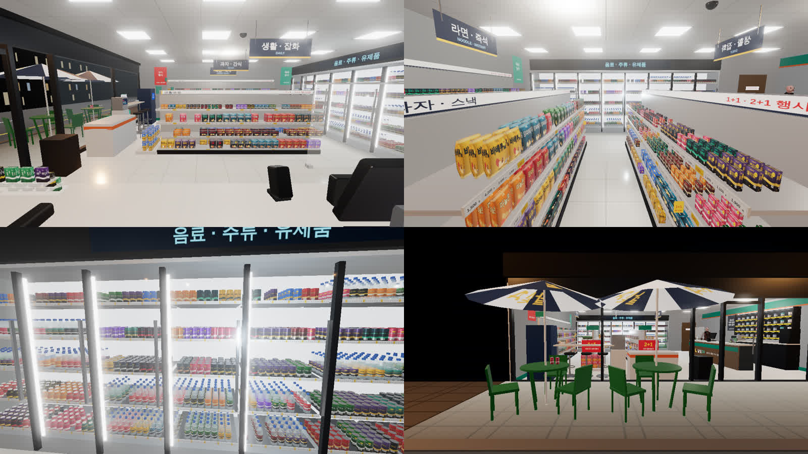

# 🌙 달빛24 야간 편의점 — 1인칭 편의점 야간 알바 게임

밤 10시부터 아침 6시까지, 편의점 계산대를 지키는 1인칭 3D 게임입니다. (모바일/PC)



## 설치 (안드로이드)
- `release/night-shift.apk` 를 폰에 받아서 설치 (출처를 알 수 없는 앱 허용 필요)
- 첫 실행 때 **마이크 권한 허용** → 🎤 버튼으로 실제로 말하면 손님이 알아듣고 반응합니다
- 음성인식은 폰의 Google 음성인식, 손님·사장님 목소리는 폰의 한국어 TTS 를 씁니다

## PC 브라우저로 하기
```
python3 -m http.server 8080   (저장소 최상위에서)
→ http://localhost:8080/nightshift/
```
크롬에서는 음성인식(마이크)이 됩니다. 스페이스바 = 말하기.

## 조작
- 왼쪽 아래 **조이스틱**으로 걷기 (PC: WASD, Shift 달리기) — 창고(STAFF ONLY 문)·바깥 거리까지 걸어 다닐 수 있음
- **봉투**: 구겨진 비닐봉투를 꺼내 상품을 하나씩 담아 건넴 (바스락 소리)
- **공격**(주먹/권총/소총): 총은 창고의 총기 보관함에서 꺼냄(소총은 누르고 있으면 연사). 피 효과·탄흔·탄피. 사람을 해치면 경찰 출동(경찰관이 당하면 지원 출동) → 체포 → 법정(판사 3명·검사·변호인·경위·방청객) 선고 → 게임 오버. 법정에서 폭력을 쓰면 특공대 진압 → 사형
  - 총은 두 손으로 쥠(권총: 이등변 파지, 소총: 손잡이+총열 덮개). 걸으면 발걸음에 맞춰 흔들리고, 달리면 총구를 내림, 쏘면 반동
  - 맞은 부위별 반응: 머리(즉사, 고개 젖혀짐) · 가슴(뒤로 비틀대다 쓰러짐) · 배(웅크리고 무릎 꿇은 뒤 앞으로 고꾸라짐) · 팔(팔 움켜쥠) · 다리(한쪽 무릎 꿇고 주저앉음)
  - 총구를 겨누면 손 들고 멈춤, 다친 사람은 무릎 꿇고 두 손 비비며 살려 달라고 빎. 실제 녹음 비명·신음·숨소리
- **이번 정리**: 화면 알림·말 자막·평판 별 없앰(목소리만 들림), 공격 버튼 대신 총을 들면 '발사' 버튼, '달리기' 버튼, 계산하기 한 번이면 남은 상품 바코드·담배까지 자동으로 찍고 결제
- **총**: 실제 녹음 총소리(9mm 권총·5.56mm 소총, 실내/실외), 탄피 구르는 소리, 빈 총 소리, 실제 탄창·슬라이드 장전 소리. 허리춤에서 뽑아 올려 슬라이드 당기는 꺼내기 동작·넣기 동작, 각인(제조사·일련번호·조정간 표시)
- **사람**: 사진처럼 부드럽게 내려앉은 머리(앞머리 눈썹 위, 옆머리 귀 윗부분), 옷 주름·피부 결, 출발·정지할 때 서서히 빨라지고 느려지는 걸음
- **세월 흔적**: 건물 외벽 빗물 자국·얼룩·밑동 때, 실외기·배수관, 창틀. 차에 총을 쏘면 탄흔이 남고 유리가 금 가고 많이 맞으면 연기 나며 멈춤(운전자 도망), 벽은 파편·먼지
- **겹침 방지**: 가로등·나무·서 있는 차를 사람과 내가 통과하지 못함, 경찰은 계산대를 돌아서 옴
- **그래픽**: 2K 실사 재질(젖은 아스팔트의 물웅덩이 반사·균열, 보도블록, 콘크리트, 광택 타일, 벽돌·원목·대리석·잔디), 사진 나뭇잎 나무(바람에 흔들림), 실시간 그림자(가로등·매장 조명), 주변광 차폐(GTAO, 최상), SMAA 안티에일리어싱, 영화 색보정(LUT), 거리 반사 환경맵, 페라리·업소용 냉장고·벨벳 소파 실제 모델. 설정에서 최상/상/중/하
- **달빛지방법원 (교도소 옆 블록)**: 돌기둥 현관·계단·박공 지붕·간판, 자동 유리문, 로비(금속탐지 검색대·X선 검색기·안내 데스크·대기 의자·층별 안내), 법정을 둘러싼 복도. 평소에도 걸어 들어가 볼 수 있음
- **법정 탈출 (GTA식)**: 재판 중 법정 문을 열고 뛰쳐나가면 '법정 도주', 총을 쏘거나 때리면 난동 → 재판이 멈추고 법정 경위가 쫓아옴(공격했으면 총을 쏨). 건물 밖으로 도망치면 경찰 추적. 경위·경찰도 쏴서 쓰러뜨릴 수 있음(살인으로 처리). 다시 잡히면 도주죄(형법 제145조)가 더해져 재판
- **경찰에게 닿으면 체포**: 수배 중에 경찰 몸에 닿으면 바로 체포(빠르게 달리는 차 안은 제외)
- **달리기**: 버튼을 누를 때마다 켜기/끄기, 더 빨라지고(초속 5.4m) 시야가 살짝 넓어짐. 조이스틱을 끝까지 밀어도 달림
- **GTA식 지도**: 밝은 도로·초록 공원·파란 강, 목적지까지 보라색 길 안내선(미니맵·큰 지도), 법원 표시, 조준하면 행인·경찰·법정 사람 모두 표시됨
- **GTA식 법·재판 (실제 대한민국 법 조항)**: 체포되면 법정에서 검사가 혐의·적용 법조(형법 제250조 살인죄, 제260조 폭행죄, 제258조의2 특수상해죄, 제136조 공무집행방해죄, 제333조 강도죄, 제145조 도주죄, 교통사고처리 특례법, 도로교통법 난폭운전)를 읽고 구형, 변호인 변론, 재판장이 법정형을 말하고 선고. 게임오버 없음: 벌금형이면 벌금 내고 바로 석방(총 압수), 징역이면 달빛교도소 수감. 감방 침대에서 잠자면 형기가 흘러가 다 채우면 출소(무기징역은 20년 뒤 가석방, 사형수는 탈옥만 가능). 재판 중에도 법정 안을 걸어 다닐 수 있음(벽·법대·방청석 충돌). 법정에서 난동을 부리면 특공대 진압 → 병원
- **경찰이 감옥까지 쫓아와 다시 재판으로 가던 버그 수정**: 체포·재판·수감·출소 때 경찰과 순찰차가 모두 철수
- **사람이 건물·물건을 뚫지 않음**: 가게 안 손님을 빼고 모든 사람(행인·경찰·깡패·도둑)이 벽·진열대·기둥에 막힘. 경찰·깡패는 길찾기(A*)로 건물을 돌아서 쫓아옴
- **목소리**: 사람마다 음높이·빠르기·목소리 종류를 따로 정해서 모두 다르게 들림. 직접 말하기(마이크)는 없애고 대답은 화면 선택지로
- **감옥 내부 정리**: 큰 칸막이·큰 낙서 없앰, 2층 침대(매트리스·시트·베개·개어 둔 이불), 벽걸이 TV, 밝은 장판, 따뜻한 형광등
- **서울만큼 큰 도시 (약 26km × 24km ≈ 620km²)**: 달빛동 밖으로 길이 그대로 이어지고 순환도로가 둘러쌈. 가까운 구역만 그때그때 만들고 멀어지면 치워서 폰에서도 돌아감. 도심 업무지구·강남 업무지구·여의 금융지구(유리 고층 빌딩), 아파트 단지(동 번호), 빌라촌, 상가 거리(간판·셔터·실외기), 공원(연못), 학교 운동장, 외곽 숲. 도시를 가로지르는 **한강**(강변 공원·자전거길·난간)과 차로 건널 수 있는 다리(교각·가로등), 멀리 도시를 둘러싼 산 능선과 전망타워 불빛. 바깥 도로에도 차가 다니고(앞에 사람·차 있으면 멈춤) 길가에 세워진 차는 타고 갈 수 있음, 보도엔 행인
- **현실 물리엔진 (cannon-es)**: 내가 탄 차·자전거는 질량 있는 강체라 건물·벽·차에 실제로 막히고 튕김(세기에 따라 쿵 소리·화면 흔들림). 지나가는 차를 세게 들이받으면 사고 차량이 되어 미끄러지며 돌다 멈춤(난폭 운전 신고). 길가 쓰레기통(일반/재활용)·라바콘·택배 상자·맥주 상자·가게 앞 플라스틱 의자는 밀면 밀리고 차에 치이면 날아가 넘어지고 굴러감(부딪히는 소리)
- **사람**: 비 오면 우산을 펴서 들고 다님, 백팩·쇼핑백을 든 사람
- **지도**: 수도권 전체까지 축소 가능(구역 색·한강·도로·업무지구 이름), 확대하면 건물까지
- **살인 판정**: 사람이 실제로 숨져야만 살인자. 다치게만 하면 '폭행'(경찰이 총을 쏘지 않고 체포, 재판은 징역형), 죽이면 '살인'(무장 경찰이 총을 쏨, 행인이 알아보고 "살인자다!" 비명·신고, 재판에서 무기징역/사형). 남이 낸 교통사고 사망은 내 죄가 아님. 혐의(폭행·차량 탈취·탈옥 등)에 따라 체포 대사·판결이 달라짐
- **경찰이 몸을 뚫지 않음**: 경찰은 내 앞 0.9m에서 멈추고 둘이 양옆으로 나뉘어 다가옴, 서로 겹치지 않음. 경찰차는 앞에 사람이 서 있으면 멈춤. 차 안에 있으면 차 문 앞까지 와서 "차에서 내려!" 하고 끌어내 체포
- **운전**: 세워진 차·자전거 가까이 가면(차체 어느 쪽이든 1.5m) 파란 **'차 타기'** 버튼이 깜빡이며 나타남. 지도에 탈 것 위치(주황 네모) 표시
- **달빛교도소 (도시 남서쪽)**: 차로 가 볼 수 있는 실제 교도소. 6.5m 콘크리트 외벽 + 윤형 철조망, 감시탑 4개, 정문(간판·초소·차단기·표지석·깃발), 행정동. 수용동은 2층 구조(감방 8칸: 2층 철제 침대·스테인리스 변기·세면대·선반·작은 창·벽 낙서, 철창문·호실 번호), 휴게 공간(철제 식탁·TV·교도관 유리 부스·게시판·시계·CCTV·계단·2층 통로). 운동장(농구 골대·철봉·벤치·투광등, 가시철선 울타리)을 탐조등이 훑음. 수감되면 수용복 차림, 옆 방 수용자들이 말을 걺. 개구멍으로 탈옥하면 교도소 담장 밖 길로 나옴
- **지도**: 큰 지도를 끌어서 이동, +/− 확대·축소, '내 위치'. 교도소·달빛타워·달빛 커피·탈 것 표시
- **렉 줄이기**: 조명 수를 고정(가까운 불빛 4개만 실제 계산 → 셰이더 재컴파일 없음), 움직이지 않는 건물·가구 메시 병합, 먼 차는 간단한 모형(LOD), 총구 섬광 조명 재사용, 폰은 기본 '중' 화질. 한 프레임 삼각형 수 약 1/3
- **편의점 색감**: 초록 간판·천장 조명이 과하게 빛나던 것 낮춤(블룸 기준·노출·색보정 조정)
- **날씨**: 몇 분마다 비가 오고 그침(빗줄기, 실외/실내 빗소리 다름), 번개 번쩍 → 몇 초 뒤 천둥
- **새벽**: 05시 이후 하늘이 점점 밝아짐
- **청소**: 가끔 바닥에 음료가 쏟아짐 → 대걸레 들고 닦기
- **ATM**: 은행 잔고 ↔ 지갑 입출금(수수료 1,300원) · **컵라면 조리대**: 사 먹으면 체력 회복
- **택배 접수**: 손님이 택배 상자를 맡김 → 무게 재고 선불 4,000원 추가
- **휴대폰 기능 추가**: 카메라(사진 찍기, 화면 UI 숨김)·갤러리·통계(손님 수·청소·걸은 거리·운전 거리)·업적 10개
- **GTA식 자유 행동**: 휴대폰(📱)에서 스토리 미션 8개·일자리(편의점/배달 라이더/택시 기사)·지갑·지도. 화면 위 목표(빛기둥 + 방향 화살표 + 거리)
- **탈것**: 아무 차나 문 열고 타기(운전자는 끌려 나와 도망 → 수배), 운전석 시점(핸들·계기판)/뒤에서 보기, 가속·브레이크·후진·핸들, 건물·차와 충돌, 경적. 자전거·배달 스쿠터. 시내버스는 정류장에서 문이 열리면 타고(실내 좌석·기둥) 다음 정류장에서 내리기
- **경찰 추적·전투**: 범죄가 쌓이면 경찰이 늘고 총을 쏨(별 표시는 없음), 내 체력(맞으면 화면 붉어짐, 쉬면 회복, 쓰러지면 병원), 동네 깡패가 시비 걸고 주먹질·총질, 차에 치이면 사람이 날아가 다침
- **들어가는 곳**: 창고 바닥 계단 → 지하 무기고(총기 보관함 2개·탄약 상자·작업대), 달빛타워(로비·엘리베이터·5층 사무실·옥상 야경), 달빛 커피(아메리카노로 체력 회복)
- **교도소**: 재판 후 호송차 → 달빛교도소 감방 → 환풍구 뜯기(3번) → 운동장(탐조등·순찰 교도관 피하기) → 울타리 개구멍 → 탈옥(경찰 추적)
- **살아 있는 동네**: 사람끼리 부딪히고 비켜 감, 부딪히면 "죄송합니다"/"앞 좀 보고 다녀요!", 진열대에 부딪히면 물건이 흔들리고 떨어짐, 바람에 흔들리는 나무, 길고양이(다가가면 도망), 비둘기(날아감)
- **도시**: 약 770m × 510m, 도로 14개·건물 700여 채(도심 고층 빌딩가, 아파트 단지 101~116동, 옛 골목, 달빛공원·연못, 달빛초등학교 운동장), 차·버스·택시 30여 대, 밤하늘(달)
- **지하도(달빛 지하상가)**: 편의점 앞 큰길 아래. 양쪽 보도 계단으로 내려가면 넓은 지하 보도(셔터 내린 가게·불 켜진 가게, 광고 기둥, 벤치, 자판기, 출구 안내판)
- **행인**: 보도·지하상가를 걷고 휴대폰 보기·통화. 총소리 → 멈칫하고 돌아봄 → 비명 지르며 도망 / 웅크리고 머리 감싸기 / 112 신고. 쓰러진 사람을 보면 입 막고 신고
- **머리카락**: 머리결 카드 수백 장(앞머리·가르마·투블럭), 움직이면 흔들림
- **총**: 권총(톱니 슬라이드·배출구·야광 가늠쇠·돌기 손잡이), 소총(M4형 상하부 리시버·장전손잡이·8각 총열덮개·도트사이트). 쏘면 슬라이드/노리쇠 후퇴·연기·탄피, 탄창(권총 15발·소총 30발) 다 쓰면 자동 장전 동작(무기 버튼 길게 누르기/R 키로도 장전)
- **지도**: 왼쪽 위 원형 미니맵(내가 보는 방향이 위), 누르면 전체 지도(편의점·창고·버스 정류장·사람·경찰 표시)
- 버튼은 엄지로 누르기 쉽게: 왼손 조이스틱, 오른손 아래 부채꼴(바코드 찍기·계산하기·공격·마이크·봉투·뒤돌기)
- 바깥: 3×3 블록 도시, 건물·간판·가로등·신호등·버스정류장, 승용차·택시·시내버스가 다님
- 화면을 끌어서 둘러보기 · 화면 가운데 **점**으로 조준
- **바코드 찍기**: 점을 상품에 맞추고 누르면 → 손으로 집어 핸드 스캐너로 "삑" (담배에 맞추면 *담배 꺼내기*, 전자레인지면 *데우기*)
- **포스기**: 15인치 터치 모니터(판매 목록·합계·결제 버튼), POS 키패드, 탁상 계산기(거스름돈 표시)
- **계산하기**: 점을 계산대(포스기)에 맞추고 누르면 → 점원이 "총 만 이천 원입니다" 하고 알아서 결제
  - 카드: 손님이 단말기에 꽂고 승인 → 영수증 출력
  - 현금: 손님 돈을 집어 돈통을 열고 칸에 넣은 뒤, 거스름돈을 꺼내 건넴 ("거스름돈 삼천오백 원입니다")
- 손님과의 대화는 화면 선택지로 ("어서오세요", "봉투 필요하세요?", "죄송하지만 안 됩니다", "감사합니다, 안녕히 가세요" …)
- 술·담배는 계산하기 때 신분증 확인 여부를 묻고, 미성년자에게 팔면 큰일!
- 진상(취객·반말·깎아달라·환불·도둑), 사장님 순찰·시재 점검 · 손가락 마디까지 움직이는 손 · 흔들면 출렁이는 음료

## 만든 것
- `js/store.js` 편의점 실내(진열대·워크인 냉장고·계산대·담배 진열장·전자레인지·ATM)와 바깥 밤거리
- `js/people.js` 손님·사장님 3D 모델 + 동작 리타기팅(월드 회전 기준)
- `js/vehicles.js` 실제 차량 모델(지나가는 자동차, 가게 앞 배달 스쿠터)
- `js/hands.js` 1인칭 실제 사람 손·팔 모델 + 소매 + 편의점 조끼(명찰)
- `js/game.js` 손님 흐름, 계산·거스름돈·담배·신분증·진상·사장님·음성 대화
- `js/courthouse.js` 법원 건물, `js/nav.js` 길찾기(A*), `js/metro.js` 서울 크기 수도권 (구역 단위로 불러오기), `js/physics.js` 물리엔진·길가 물건
- `android/` WebView 앱 (네이티브 음성인식·TTS 연결), `android/build-apk.sh` 로 APK 빌드

## 에셋 출처
- 손·팔: "Hand and arm - Zbrush sculpt" by Andy Woodhead (CC BY 4.0)
- 사람 모델·동작: three.js 예제 모델 (Michelle, Ready Player Me 아바타, Mixamo X Bot 동작)
- 자동차: "Jeep Wrangler Adventure Rubicon" by vecarz (Sketchfab, CC BY-NC-SA 4.0, 비상업용) — gkjohnson/3d-demo-data 에서 최적화
- 배달 스쿠터: "Vino" by minghauLoh (https://sketchfab.com/3d-models/vino-2205f4e69bc64df3aab03c71ab9d7492, CC BY 4.0)
- 효과음: `assets/sfx/CREDITS.md` 참고 (실제 녹음 효과음)
- 물리엔진: cannon-es 0.20 (MIT, `vendor/cannon-es/LICENSE`)
- 목소리: 폰의 한국어 음성합성(구글 TTS 우선) — 손님마다 남/여 목소리를 따로 씀, 설정에서 고를 수 있음
- 상품·담배·가게 이름은 모두 가상의 이름입니다
